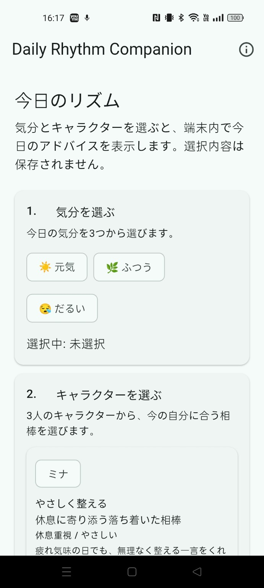
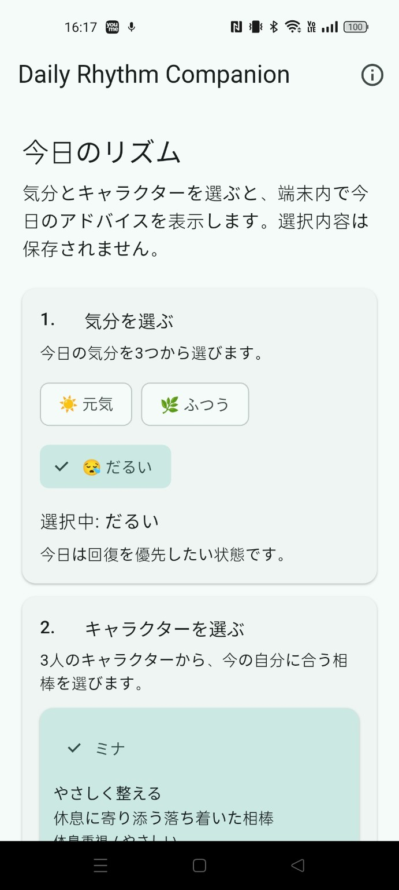
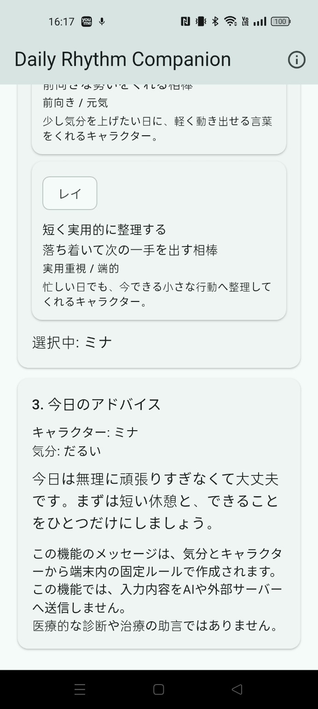

# Daily Rhythm Companion v4.1.0 GitHub Android Public Beta

> GP-7 の Release 本文案です。Android 開発者確認・パッケージ登録と Release 公開は未完了です。APK のダウンロードリンクは Release 公開時に確定します。

## このベータでできること

気分とキャラクターを選ぶと、端末内のルールで今日のアドバイスを表示します。選択と表示結果は永続保存されず、アプリから外部にも送信されません。このベータの対象機能は気分・キャラクターの選択とアドバイス表示です。睡眠・健康データ連携、テキスト会話、履歴は今後の対象です。

## スクリーンショット

1. **選択前のメイン画面**

   

2. **気分とキャラクターを選択**

   

3. **今日のアドバイスを表示**

   

## 対応端末

インストールには **Android 7.0（API 24）以上**と **ARM64（`arm64-v8a`）** が必要です。実機検証は A301OP（Android API 34、`arm64-v8a`）で行い、新規インストール、起動、アドバイス表示、検証専用 `versionCode=5` からの上書き更新を確認しました。別画面サイズの実機確認は保留です。

## APK とインストール

公開後は[公式 GitHub Releases](https://github.com/murayan1982/daily-rhythm-companion-public/releases)の v4.1.0 Android Public Beta の **Assets** から APK を取得し、ファイルの SHA-256 を照合してから開いてください。

| 項目 | 検査済みの署名済み候補 |
| --- | --- |
| ファイル名 | `DRC_v4.1.0_arm64_signed_candidate.apk` |
| サイズ | 15,081,786 バイト |
| バージョン | `versionName=4.1.0` / `versionCode=6` |
| APK の SHA-256 | `A50D6987B8E059A49FFF1FB340A7081293617DE9EE784E3304547BA17FDCE373` |
| 署名証明書の SHA-256 | `27:1F:75:FE:3B:19:8B:AC:A9:4F:31:AE:2B:65:8C:7B:FC:99:88:1A:2C:C3:5C:68:FE:89:38:0B:FE:CF:8C:E5` |

SHA-256 の確認方法、インストール許可、上書き更新、アンインストール、端末上のデータ消去の手順は[Android インストール案内](https://github.com/murayan1982/daily-rhythm-companion-public/blob/main/docs/v410_android_install_guide.md)をご覧ください。

## プライバシーとサポート

データの取扱いは[プライバシーポリシー](https://github.com/murayan1982/daily-rhythm-companion-public/blob/main/PRIVACY.md)をご覧ください。インストールや使い方については[サポート窓口（メール）](mailto:murayan1982@gmail.com)へご連絡ください。

Daily Rhythm Companion は [AI Character Framework](https://github.com/murayan1982/ai-character-framework) を活用して開発しています。
